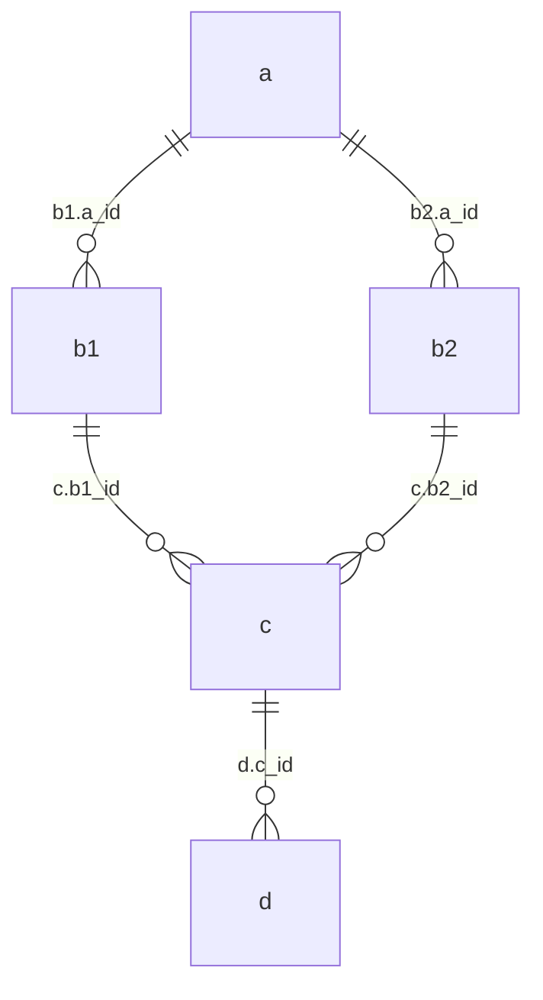
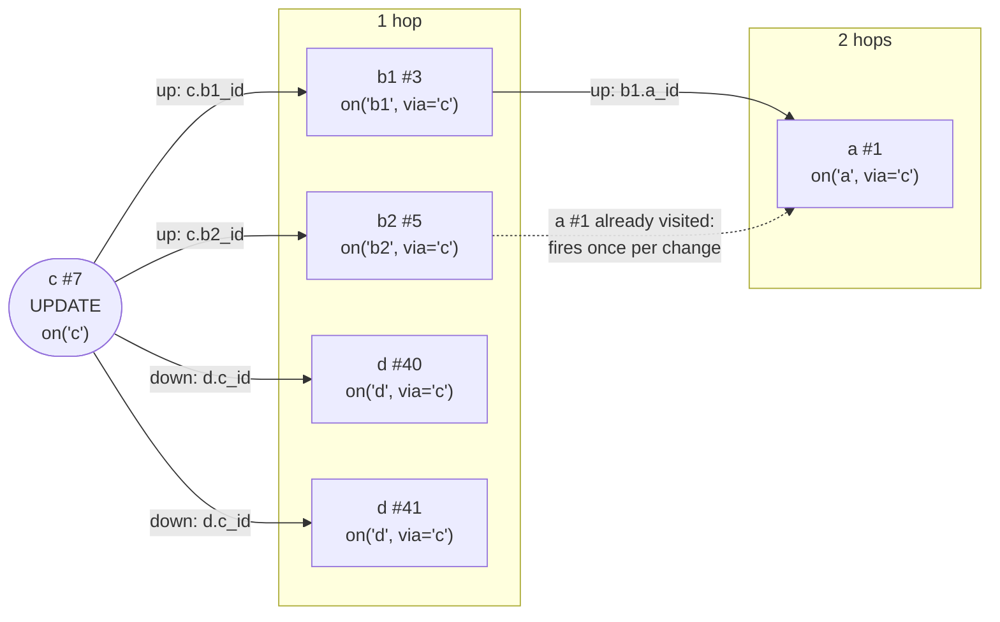
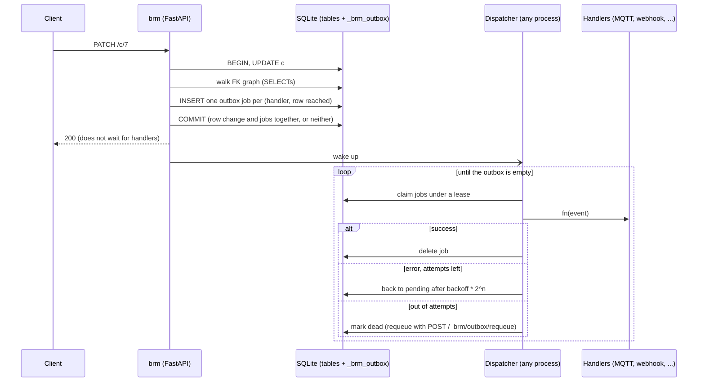

# brm: Best Relational Model

Write your database as plain SQL DDL. brm then

- **serves CRUD routes** for every table over FastAPI, with Pydantic models generated
  from the columns and OpenAPI docs at `/docs`;
- **runs handlers when rows change.** A handler is a plain function you register on a
  table. A change walks the foreign-key graph (BFS or DFS), so a handler on one row can
  fire because a related row changed. Typical uses are "ping me over MQTT when any
  reading under this device arrives" or "tell every sensor when its device goes offline".

```sql
-- schema.sql
CREATE TABLE device  (id INTEGER PRIMARY KEY, name TEXT NOT NULL, online BOOLEAN NOT NULL DEFAULT 1);
CREATE TABLE sensor  (id INTEGER PRIMARY KEY, device_id INTEGER NOT NULL REFERENCES device(id) ON DELETE CASCADE,
                      kind TEXT NOT NULL, max_value REAL);
CREATE TABLE reading (id INTEGER PRIMARY KEY, sensor_id INTEGER NOT NULL REFERENCES sensor(id) ON DELETE CASCADE,
                      value REAL NOT NULL);
```

```python
# app.py
from brm import App
from brm.handlers import MQTT, when

app = App("iot.db", schema="schema.sql")
bus = MQTT("broker.local")

# a sensor or reading anywhere under a device changed -> MQTT ping on brm/device/<id>
app.on("device", bus.publish("brm/device/{key}"), via=["sensor", "reading"], retries=3)

# a new reading of this sensor over its threshold; `where` runs in the write's
# transaction, so readings under the threshold never queue a job
@app.on("sensor", via="reading.sensor_id", ops="insert",
        where=lambda ev: ev.row["max_value"] is not None
                         and ev.change.new["value"] > ev.row["max_value"])
def over_threshold(ev):
    print("alert", ev.row, ev.change.new)  # ev.row: the sensor; ev.change.new: the reading

# a device went offline -> every sensor below it hears about it (device is above: walks down)
app.on("sensor", lambda ev: print("offline:", ev.row), via="device", ops="update",
       where=lambda ev: ev.change.new["online"] == 0)
```

```sh
pip install -e '.[mqtt]'
uvicorn app:app          # an App is an ASGI app; or mount app.router() in your own FastAPI
```

## How propagation works

A generic schema. Every table `x` that holds a foreign key to `y` is a *child* of `y`.
`c` references both `b1` and `b2` (a diamond), and `d` hangs below `c`. The same shape
continues to any depth or width.

```sql
CREATE TABLE a  (id INTEGER PRIMARY KEY);
CREATE TABLE b1 (id INTEGER PRIMARY KEY, a_id  INT REFERENCES a(id));
CREATE TABLE b2 (id INTEGER PRIMARY KEY, a_id  INT REFERENCES a(id));
CREATE TABLE c  (id INTEGER PRIMARY KEY, b1_id INT REFERENCES b1(id), b2_id INT REFERENCES b2(id));
CREATE TABLE d  (id INTEGER PRIMARY KEY, c_id  INT REFERENCES c(id));
```



Suppose row `c #7` is updated. Handlers on `c` with no `via` fire on `c #7` itself.
Handlers whose route **starts at `c`** are walked out along their foreign keys, one hop at a
time; each column below is one BFS level. A handler on `a` with `via="c"` is reached going
**up** (c → b1/b2 → a). A handler on `d` with `via="c"` is reached going **down** (c → d).
The direction comes from the schema; you never state it.



- `via="c"` means any route from `c`. `a #1` is reached through both `b1` and `b2`, but
  fires once. `via="c.b1_id > b1.a_id"` names one exact route, and walks only that one.
- A bare-table route goes one way only, all up or all down. It never turns around to
  `b1 #3`'s other `c` rows. To turn around on purpose, spell it out:
  `on("c", via="c.b1_id > <c.b1_id")` is "the other `c` rows under the same `b1`".
- Only routes that start at the changed table are walked, and only along their own foreign
  keys. A change in a table nobody routes from costs no lookups at all.
- If the update had moved `c #7` from `b1 #3` to `b1 #9`, both `b1 #3` and `b1 #9` would be
  visited.

When it happens, relative to the write:



## Routes

For each table `t` with primary key `k`:

| method | path | |
|---|---|---|
| GET | `/t` | list rows. `?col=value` filters (`null` means IS NULL), `_limit` (default 100, max 1000), `_offset`, `_order=col,-col` |
| POST | `/t` | create; returns the row (201) |
| GET | `/t/{k}` | one row. Composite keys are written `a,b` |
| PATCH | `/t/{k}` | update the given columns; key columns cannot be changed |
| DELETE | `/t/{k}` | delete; returns the deleted row |
| GET | `/t/{k}/child` | rows of `child` that reference this row (`child.col` when there are several FKs to `t`) |
| GET | `/_schema` | tables, columns and the FK graph |
| GET | `/_brm/outbox` | job counts per status and handler |
| GET | `/_brm/outbox/{dead,pending,running}` | list jobs with their events and last error (`?handler=`) |
| POST | `/_brm/outbox/requeue` | retry dead jobs: all, `{"ids": [...]}` or `{"handler": "..."}` |
| DELETE | `/_brm/outbox/dead` | discard dead jobs (`?handler=`) |

A foreign-key, UNIQUE or NOT NULL violation returns 409; a bad body returns 422; an unknown key returns 404.
Tables without a declared primary key are addressed by `rowid`.

## Handlers

```python
app.on(table, fn=None, *, via=None, ops=None, where=None, max_hops=None,
       retries=0, backoff=0.5, name=None)
```

`via` says **where the change comes from**, using the schema's own foreign keys. It is
written from the changed table to the handler's table:

| `via` | fires on a row of `table` when… |
|---|---|
| `None` | that row itself was inserted, updated or deleted |
| `"reading"` | a related `reading` changed, by any route (all up or all down; brm works out which) |
| `"reading.sensor_id"` | a `reading` changed that points at this row through exactly that key |
| `"reading.sensor_id > sensor.device_id"` | a `reading` changed, related through exactly this path |
| `"device > sensor.device_id"` | a path that starts by going down: a leading table names the start |
| `"node.parent*"` / `"<node.parent*"` | self-reference repeated: every ancestor / every descendant node |
| `"sensor.device_id > <sensor.device_id"` | up then back down: the other sensors on the same device |
| `["sensor", "reading"]` | several routes, one registration each |

Each hop names a foreign key by its child side, as `table.column` (`table.a,b` for a
composite key). brm decides whether each hop goes up (child → parent) or down
(parent → children) from where the path currently is. A leading `<` forces a hop down,
which only matters for self-references. **Routes are checked against the schema when you
register them**, so a schema change that breaks a route fails at startup, with the reason,
instead of silently never firing.

- `ops` limits which operations of the changed row count: `"insert"`, `"update"` or
  `"delete"`.
- `where(event)` runs **inside the write's transaction**, so events it rejects are never
  queued. Keep it fast and free of side effects. If it raises, the error is logged and the
  job is queued anyway.
- `max_hops` caps a walk, which is mostly useful with `*`.

A handler receives an `Event`:

- `ev.table`, `ev.row`, `ev.key`: the row the handler is registered on.
- `ev.via`: the route that reached it, or `None` for the row itself. `ev.depth` is the
  number of hops walked.
- `ev.path`: every `Hop(table, key, via, row)` from the changed row (`path[0]`) to this one.
  `ev.at("sensor")` returns the sensor on the way.
- `ev.change`: the change itself, with `table`, `op`, `key`, `old`, `new`, `.row` and
  `.changed` (the set of columns that changed).

### When they run: the durable outbox

1. A write plans its walk **inside its transaction**. A write is a call over HTTP, a call
   to `app.insert/update/delete`, or several grouped in `with app.transaction() as tx:`.
   Inserts and updates are planned after the write and deletes before it, so rows that
   `ON DELETE CASCADE` will remove are still reached.
2. Each (handler, row reached) pair becomes a row in **`_brm_outbox`**, written in that same
   transaction. The change and its jobs commit together. A rollback leaves no jobs, and a
   crash after commit loses none.
3. A **dispatcher** claims jobs under a lease (`App(lease=60)` seconds), runs the handler,
   and deletes the job. It is woken right after each commit and otherwise polls every
   `App(poll=0.25)` seconds. A slow or failing handler never blocks or rolls back a write.
4. If a handler raises, the job goes back to pending and waits `backoff * 2**n` before the
   next attempt; jobs behind it are not held up. After `retries` extra attempts it is
   marked **dead**. Dead jobs stay in the table with their event and last error, are passed
   to `App(on_error=...)`, and can be requeued with `app.outbox.requeue()` or
   `POST /_brm/outbox/requeue`.
5. If a dispatcher dies mid-job, its lease runs out and another dispatcher (or the same
   one after a restart) claims the job again. A crash does not use up `retries`. A job
   whose runs keep dying is marked dead after `App(max_reclaims=3)` takeovers, so one
   handler that crashes the process cannot take the queue down with it.

**Delivery is at-least-once, so make handlers idempotent.** For example, use
`ev.change.key` together with `ev.change.op` as a deduplication key downstream.

Order: with the default `concurrency=1`, jobs start in commit order, and in walk order
within a change. A job waiting to retry is overtaken by the jobs behind it. Sync handlers run
in a thread pool, and `async def` handlers are awaited.

**Handler names identify jobs across restarts.** A name defaults to
`"<table>:<function name>"`, plus `"@<route>"` when there is a `via`, and must be unique (pass `name=` to tell two handlers apart). Renaming a handler leaves
any jobs still queued under the old name waiting. Drain the queue first, or clear them with
`app.outbox.purge("pending", handler=old_name)`.

**Several processes** can share one database file, for example several uvicorn workers, or
API processes plus separate worker processes. Each claim is exclusive, so every job runs in
one process. The process that writes is the one that plans, so **every process must
register every handler**. `App(dispatch=False)` makes a process that only writes and leaves
running the handlers to the others.

How the walk behaves:

- Each related row is reached once per route per change, along the first path found. With
  `App(order="bfs")` (the default) that path is the shortest one; `order="dfs"` goes depth
  first.
- Diamonds and cycles, including self-referencing tables, are safe.
- The changed row is never reached through its own route.
- When an update moves a row to a new parent, both the old and the new parent hear about it.
- Lookups are shared between routes within a change, so the same row is never fetched
  twice.

A handler may write to the database itself; its writes are new changes. Avoid handlers that
trigger each other forever.

`app.drain()` waits until no job for this process's handlers is pending or running, which
is useful in tests and scripts. `app.off(fn)` unregisters a handler. `app.outbox.stats()`
shows the queue.

### Built-ins (`brm.handlers`)

- `MQTT(host, port, username=, password=, tls=)` is a lazily connected shared client.
  `.publish(topic, qos=1, retain=False, payload=to_json)` returns a handler, and waits for
  the broker to acknowledge the message so that `retries` apply.
- `mqtt(topic, host, port)` is shorthand for the above.
- `webhook(url, method="POST", headers=)` sends one HTTP request per event.
- `log(level)` and `collect(list)`.
- Combinators: `when(pred, fn)`, `fanout(f, g, ...)`, `changed("col", ...)` and
  `matches(col=value)`.

Topic and URL templates can use `{table} {key} {op} {via} {depth} {source} {source_key}`.
The default payload is the event as JSON.

## Schema rules

- `schema` is DDL text or a path to a `.sql` file. On an empty database brm runs it. On an
  existing database the tables must match the DDL; otherwise `SchemaMismatch` is raised.
  There are no migrations yet.
- brm turns on `PRAGMA foreign_keys` and WAL. Each process uses one connection behind a
  lock, which suits SQLite's single writer. Tables named `_brm_*` belong to brm and are
  left out of the API and the schema check.
- Changes made outside brm, such as from the `sqlite3` shell, by `ON DELETE CASCADE`, or by
  SQL triggers, do not fire handlers. Cascaded rows are reached by a downward route,
  such as `on("reading", via="device")`, from the row deleted through brm.

## Development

```sh
python3 -m venv .venv && .venv/bin/pip install -e '.[dev]'
.venv/bin/pytest
```

`examples/iot` is a site → device → sensor → reading demo. To run it with a broker:
`BRM_MQTT=localhost uvicorn examples.iot.app:app`.

## License

brm is free software under the [GNU General Public License v3.0 or later](LICENSE).
